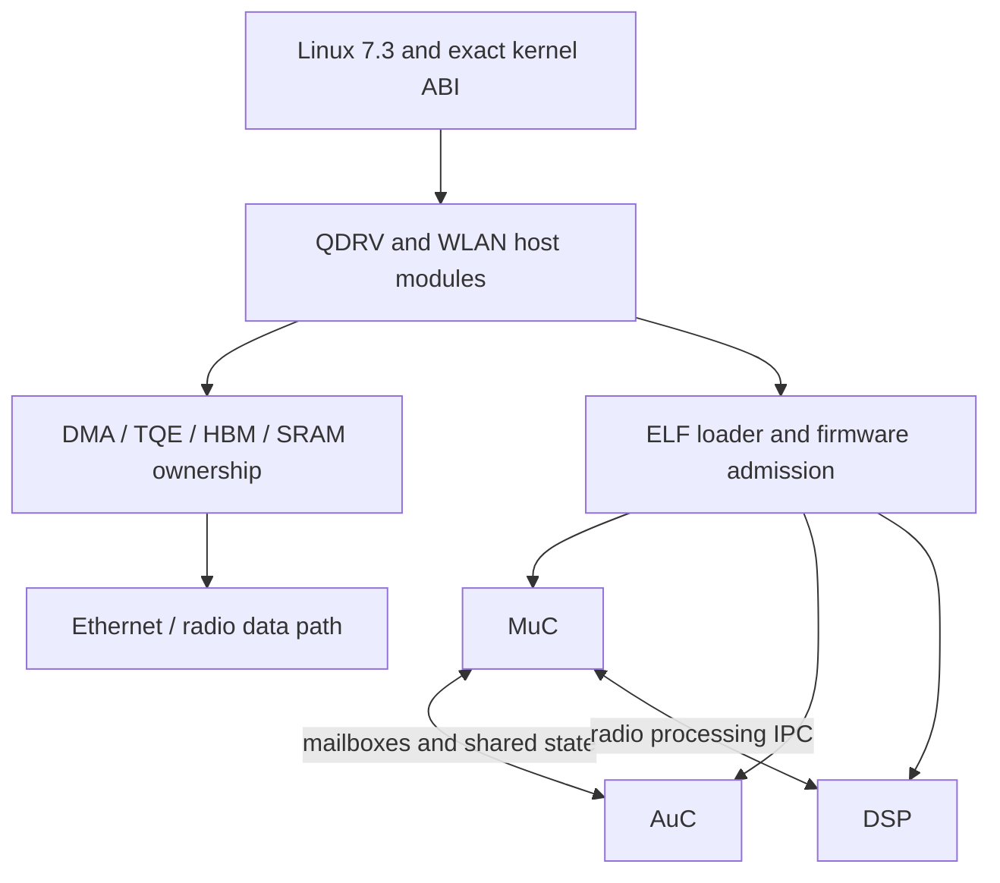

# HGW500 Quantenna host driver for Linux 7.3

> Public source snapshot. [Scope, provenance and verification](docs/PUBLIC_SNAPSHOT.md).

This is the maintained Linux 7.3 port of the Quantenna Topaz/QMAC host stack. It covers QDRV, WLAN, DMA/TQE/HBM, SRAM allocation and the loader/control interfaces used by the three radio coprocessors. Vendor source and old reference builds remain preserved.

## How this component fits



This diagram shows software ownership and analysis flow, not a complete board schematic.
The [system architecture](docs/SYSTEM_ARCHITECTURE.md) explains the ARC750 host,
MuC, AuC, DSP and Realtek 8051, with their memory and firmware boundaries.

## What is established

| Area | Recorded scope |
| --- | --- |
| Working branch | port/linux-7.3. src/CURRENT and selected manifests name a source package; they do not by themselves select the installed image. |
| Source selections | R39 has recorded bounded radio traffic; later R51/R52/R54 work has its own common-kernel, build and acceptance records. |
| Recent static work | The R54 source checkpoint addresses native receive-index and counter handling. Its paired-build evidence is not a new physical radio acceptance. |
| Integration boundary | API v2 R3 is the documented installed integration reference. Channel/width changes, global QDRV shutdown, DFS/RF qualification and long-duration load still require their own evidence. |

## Start reading here

1. [Component handoff](docs/PROJECT_HANDOFF.md): inputs, evidence and next work.
2. [System architecture](docs/SYSTEM_ARCHITECTURE.md): processors and firmware families.
3. [Firmware contents](docs/FIRMWARE_MAP.md): OEM, Core Boot R1 and API v2 R3.
4. [Repository map](docs/REPOSITORY_MAP.md): host drivers, payloads and integration.
5. [Published checkout availability](docs/CHECKOUT_AVAILABILITY.md): actual remote source inventory.
6. [Preserved technical notes](docs/REFERENCE_NOTES.md): detailed earlier results, with workstation paths normalized.

## Work in progress

Qualify channel/width transitions, complete global AuC/DSP/DMA retirement and retain fail-closed DFS behavior. Reproduce the exact kernel/module ABI before interpreting a radio failure. Historical private baseline inputs are external dependencies, not missing code to guess.

## Offline verification


```sh
python tools/verify_public_export.py
```

This checks the published file inventory. Original preservation verifiers and
receipts describe the private source checkpoint; they can require omitted native
databases or external inputs and are not a fresh public-snapshot qualification.

## Preservation and scope

This is a public source snapshot; per-unit data and original private histories remain private. Original vendor/GPL source, notices, comments,
carriers and immutable evidence retain their authorship and provenance. Derived
C is labelled as inferred analysis, not silently presented as original source.
Credentials, unit identity, calibration, personalized rootfs/flash images and
workstation-specific configuration stay outside documentation exports.

Documentation prepared 2026-11-10 from recorded source/evidence. No device access,
firmware installation, radio change or new physical qualification is implied.
