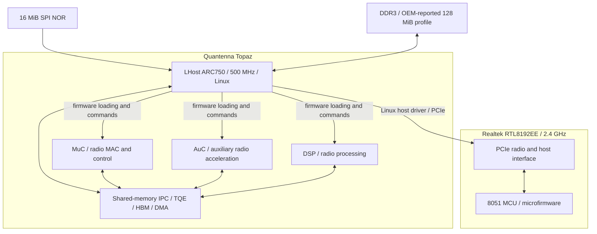
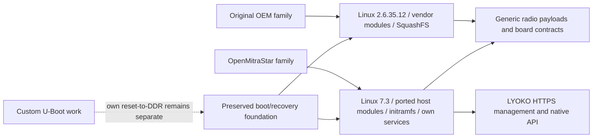

# HGW500 processing architecture

This is a software/control model for the HGW-500BNA-QCv2 A2, based on preserved
boot evidence, driver loaders and memory-interface headers. It is not a board
schematic or a claim that all five units are Linux SMP CPUs.

| Execution unit | What runs there | Relevant repository |
| --- | --- | --- |
| LHost ARC750 | Linux, host radio drivers and userland | Integration and Linux 7.3 host-driver ports |
| MuC | Generic Quantenna MAC/control carrier | Quantenna firmware collection / MuC |
| AuC | Generic auxiliary carrier | Quantenna firmware collection / AuC |
| DSP | Generic radio-processing carrier | Quantenna firmware collection / DSP |
| Realtek 8051 | 19.0 or 35.7 microfirmware variant | Realtek microfirmware analysis |

The Quantenna carrier ELFs identify ARCompact, little-endian, machine 93. The
analysis backend is ARCompact:LE:32:default. Extension and loop semantics retain
explicit limitations. The 8051 analysis instead uses 8051:BE:16:default. A host
module is ARC code for Linux; it is not the same program as either radio payload.

The 128 MiB figure is the OEM DDR profile, not proof that Linux owns all RAM or
that an independent DDR initializer has qualified every byte. Recorded Linux
memory windows are smaller. SRAM capacity and all memory reservations still need
complete attribution. TQE/HBM/FWT/DMA are hardware blocks, not extra Linux CPUs.

## Original and replacement software

Reusing a radio payload does not mean its whole semantics have been recovered.
Custom U-Boot builds have been booted/tested in the project; this is not evidence
that a completely independent boot chain and DDR initialization are finished.

## Evidence vocabulary

Original bytes, inferred pseudocode, compilable reconstruction, paired build,
RAM boot, persistent boot, client association, traffic and release acceptance
are different claims. Each belongs to a particular source selection and image.
The diagrams explain ownership and dependencies; they do not grant a physical gate.
